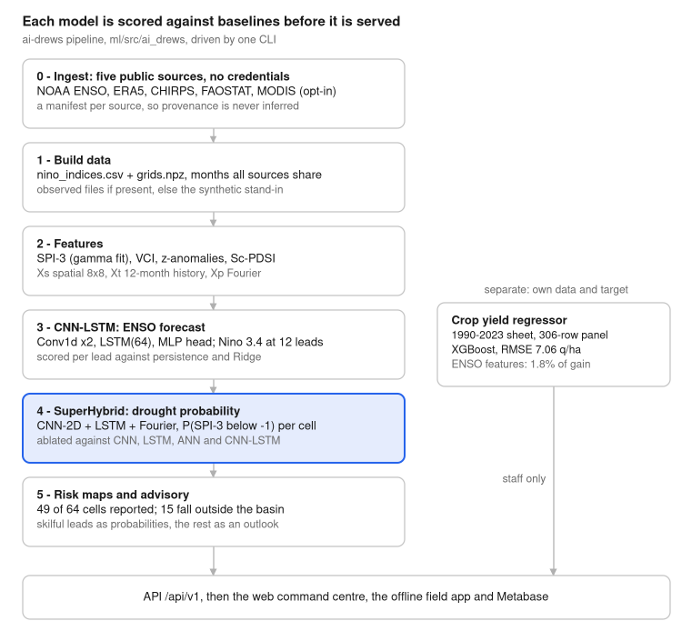

# AgriMinds AI-DREWS: What We Built

Oct 12, 2026 · Eibrahim Belayneh

## What AgriMinds is

AgriMinds AI-DREWS turns monthly climate data for the Choke Mountain Watershed in Amhara, Ethiopia into three things a decision maker can act on: a drought-probability map on an 8×8 grid, a Niño 3.4 (ENSO) outlook, and crop-specific advisories for tef, wheat and maize.

The watershed is a real surveyed catchment of 18,948 km², and the record runs 1990–2026 at monthly resolution.

Four layers are built and running:

| Layer | What it is | Size |
| --- | --- | --- |
| `ml/` | `ai-drews` Python package: ingest → features → three models → risk maps → advisory rules, driven by one CLI | 66 files |
| `backend/` | `agriminds-api` FastAPI service: PostgreSQL 17, Argon2id + JWT auth, async SQLAlchemy 2, Alembic | 84 files |
| `frontend/` | Next.js 16 web command centre, trilingual (English, Amharic, Afaan Oromoo) | 126 files |
| `mobile/` | Expo / React Native offline-first field app for development agents | 46 files |

Signing in routes each person to the view that matches their job: a farmer lands on their own plots and the advisory for the plot that needs attention first; a development agent sees the ministry view scoped to their one woreda; a minister sees the whole watershed. Every ministry figure is counted from registered database rows — farmers, plots, hectares, advisory records — with risk attached from the live model. Nothing on either dashboard is estimated.

One status caveat is carried everywhere and worth stating first: the committed deep-learning weights were trained on **synthetic** data to validate the pipeline. `make ingest` downloads the real public inputs and `make train` retrains on them. Until that has run, every API response carries a `provenance` field and both clients show a banner, so a demonstration can never be mistaken for a forecast.

## The pipeline at a glance



The chain runs in one direction and every stage writes a file the next one reads, so a run is reproducible from the CLI alone: `ai-drews run-all`. The crop-yield regressor hangs off to the side because it shares nothing with the chain but the data root — different record, different target, different artifacts.

Four further modules were built on top of the same water balance rather than beside it:

- **`hazards/flood.py`** — the *wet* end of Sc-PDSI. The same index that detects drought detects saturation, and until this was added the index was doing half its work in silence. It states plainly that this is a soil-water surplus, not a river gauge: it can say the profile cannot absorb more rain, not that a river will break its banks. Crop sensitivities are **reversed** on the wet side — tef lodges in saturated soil, maize tolerates short waterlogging — so reusing the drought multipliers here would give exactly the wrong advice.
- **`ingest/wind.py`** — 10 m wind as ERA5's u and v components, fetched **hourly** rather than daily. The archive's daily product gives a scalar mean speed and a dominant direction, and converting those two does not reproduce a vector mean: a day of reversing winds reports a high speed where the true vector mean is near zero. Over the Ethiopian highlands that is not a corner case, because the Kiremt and Bega circulations blow from opposite quarters. The download is resumable, since hourly data for the whole grid takes hours of a rate-limited archive.
- **`advisory/outlook.py`** — what to say past the lead where the model beats climatology. An outlook states which way a season is leaning and why, and **never carries a percentage**; collapsing it into the forecast would let a number with no skill reach a farmer deciding when to plant. Its direction comes from the sign of the measured teleconnection, not an assumption.
- **`analysis/teleconnection.py`** — reproduces the study's Fig. 5 ENSO-drought correlation (published as R = 0.79 for real Amhara observations) at several lags, because the ocean leads the land and the strongest lag is the one an early-warning system can act on. It computes the statistic from whatever record is loaded, so a synthetic run reports the synthetic correlation and never the published figure.

## The data foundation

Five connectors were written so a fresh clone can reach real observations with **no credentials anywhere**. `ai-drews ingest all` runs the quick ones.

| Source | Provider | Route | Gives | Time |
| --- | --- | --- | --- | --- |
| Niño 3.4, Niño 1+2, Niño 4, SOI | NOAA PSL (ERSST v6) | fixed-width tables | ENSO indices | seconds |
| Temperature, rainfall, soil moisture, evaporation | ERA5 (ECMWF) | Open-Meteo archive | the gridded climate cube | ~2 min, rate-limited |
| Rainfall for validation | CHIRPS v2.0 | SERVIR ClimateSERV zonal means | independent rainfall | ~2 min |
| Crop area, yield, production | FAOSTAT | bulk CSV | Ethiopia's official crop statistics | seconds |
| Greenness | MODIS MOD13Q1 | ORNL DAAC | NDVI → VCI | **hours**, opt-in |

MODIS is deliberately excluded from `ingest all`: the DAAC caps a request at ten composites and extracts each on demand, so a full grid takes hours. Request it by name. Without it, VCI and the greenness channels are simply absent and the model trains on the remaining channels — nothing is faked in.

`assemble` intersects the sources on the months all of them observed and writes `nino_indices.csv` and `grids.npz` (`rain`, `tmax`, `tmean`, `soilm`, `pet_fao`, optional `ndvi`, each `(T,H,W)`).

### Three decisions worth recording

**Provenance comes from a manifest, never from a file existing.** Each connector writes a tidy table to `data/raw/sources/` and a manifest to `data/raw/manifests/`. The synthetic generator writes to the same paths, so without the manifest check a second run would load its own stand-in data and stamp the model "real".

**The watershed boundary is the surveyed one.** `geo/watershed.py` reads the real ESRI shapefile (`cmw_max_boundary_wgs`, WGS84) and converts it to plain GeoJSON — no geospatial library needed downstream. The catchment measures 18,948 km² and is not rectangular, so the 8×8 forecast grid carries a mask: **15 of the 64 cells fall outside the basin** and are never reported. Publishing a drought probability for those would be publishing a number about somewhere else.

**`tmean` is required, not estimated.** Without observed mean temperature, Sc-PDSI is skipped rather than derived from the maxima, because deriving it would bias every classification downstream.

Synthetic stand-in data (`data/synthetic.py`) exists so the pipeline runs end-to-end before observations are wired in: an AR(1) ENSO-like oscillation at roughly 3.8 years, with rainfall coupled to it. It checks that the code runs. It is not evidence of skill, and it is labelled as such in every response.

## Features: what the networks actually see

The raw cube becomes three input tensors, built once in `features/fields.py` and shared by training and inference so the two cannot disagree.

| Tensor | Shape | Channels |
| --- | --- | --- |
| `Xs` spatial | `(B, C, 8, 8)` | `rain_z`, `ndvi`, `vci`, `soilm_z`, `spi` — or `rain_z`, `soilm_z`, `spi` without MODIS |
| `Xt` temporal | `(B, 12, C)` | basin means of `rain_z`, `tmax`, `soilm_z`, `ndvi`, `spi`, `vci`, plus `nino34` |
| `Xp` point | `(B, 14 + leads)` | 6 seasonal harmonics, 4 FFT amplitudes of the rain window, 4 of the ENSO window, then the 12-lead ENSO forecast |

Whichever channels were actually built are recorded inside `fields.npz`, so a deployment that ingested no MODIS trains and serves a consistent, narrower model instead of refusing to start.

### The indices

**SPI-3** (`features/indices.py`) is a proper gamma fit — per cell and per calendar month, with a separate zero-probability mass for dry months, then the inverse normal CDF. Not a z-score of rainfall.

**VCI** is the vegetation condition index, 0–100, against the same calendar month's historical min and max.

**Sc-PDSI** (`features/pdsi.py`) follows Palmer (1965) in full: Thornthwaite PET, a two-layer soil water balance, CAFEC precipitation, the Z moisture anomaly and the severity recursion. Thornthwaite was chosen over Penman-Monteith because it needs only monthly mean temperature and latitude, which is what a smallholder-scale reanalysis can be relied on to supply.

Two decisions inside Sc-PDSI are documented rather than buried:

1. **Self-calibration** rescales the two tails so the training period's 2nd and 98th percentiles land on −4 and +4 — the property the classification bands depend on. It is *not* Wells et al. (2004) duration-factor refitting, and every response carrying the index says so.
2. **The CAFEC coefficients are clipped to [0, 1].** Three are bounded by construction; runoff is not, because in a monsoon month the excess rain that runs off can exceed what Palmer counts as available to run off. Left unclipped, γ reaches about 1.13 over the Kiremt peak and the index inverts — a wetter record scores drier. A documented weakness of Palmer's formulation in strongly seasonal climates, not a tuning knob.

Palmer worked in inches and the constants of his climatic characteristic K are calibrated for that unit, so the moisture anomaly is computed in inches internally.

### The split

Chronological throughout, from `PipelineConfig`: train to 1990–2013, validate 2014–2018, test 2019 onward. A 12-month input window, 12 forecast leads. Normalisation statistics are fitted on the training window only and saved beside the weights.

## Model 1 — CNN-LSTM ENSO forecast

**What it predicts:** Niño 3.4 sea-surface-temperature anomaly, at 12 monthly leads at once, from a 12-month window of climate indices.

**Inputs:** the four observed indices — `nino34`, `nino12`, `nino4`, `soi` — standardised on the training window.

**Architecture** (`models/enso_cnnlstm.py`, 3 blocks): two `Conv1d(k=3)` layers extract local patterns across the window, a single-layer `LSTM(hidden=64)` carries temporal dependence, and an MLP head emits all 12 leads. Attribute names are part of the saved `state_dict` contract and cannot be renamed without a version bump.

**Training:** MSE loss, Adam at 1e-3, batch 32, up to 150 epochs with early stopping at patience 15, seed 42.

**Scored against two baselines**, per lead, on RMSE / MAE / correlation: persistence (today's value held flat) and a Ridge regression on the flattened window. The scorecard goes to `data/outputs/enso_metrics.csv`. Scoring per lead rather than in aggregate is deliberate — it exposes the spring predictability barrier instead of averaging it away. Skill beyond roughly nine months is poor and the table shows that.

**Outputs:** `models/enso_cnnlstm.pt`, `models/enso_norm.npz`, and `processed/enso_forecast.csv` — a 12-lead forecast for every month of the record, which is what Model 2 consumes.

One honest caveat is written into the code: the forecasts covering the training years are **in-sample and therefore optimistic**. Cross-fitted forecasts are the correct fix and are not yet done.

## Model 2 — SuperHybrid drought probability

This is the core deliverable. **What it predicts:** the probability that SPI-3 falls to ≤ −1 — a seasonal drought event — for every grid cell, at each of 12 monthly leads. Output shape `(B, L, 8, 8)` of logits.

**Architecture** (`models/drought_superhybrid.py`): three branches that are fused rather than concatenated blindly.

1. A **CNN-2D** branch over `Xs` — two `Conv2d(k=3)` layers to 32 channels, no pooling, so each cell keeps its location.
2. An **LSTM** branch over `Xt` — the 12-month basin-wide history, hidden 64.
3. A **Fourier** branch over `Xp` — seasonal harmonics, FFT amplitudes and the ENSO forecast, through a 32-unit layer.

Branches 2 and 3 are joined into a 32-dim basin-wide context vector with dropout 0.2, broadcast across all 64 cells, and concatenated onto the spatial feature map. A 1×1 convolutional head then emits one logit per lead per cell. Location-specific detail comes from the CNN; basin-wide state comes from the other two.

**Four baselines were implemented and scored at every lead**, which is what makes "super-hybrid" a claim rather than a label:

| Baseline | What it removes |
| --- | --- |
| CNN | the temporal and Fourier branches |
| LSTM | the spatial and Fourier branches |
| ANN | all structure — pooled spatial + flattened features through an MLP |
| CNN-LSTM | the Fourier branch only (a direct ablation of SuperHybrid) |

**Scoring** writes three CSVs: `drought_metrics.csv` (per-lead AUC, Brier skill score, accuracy, precision, recall, F1, Pearson R and the full TP/FP/TN/FN confusion matrix), `model_comparison.csv` (SuperHybrid vs all four baselines at every lead) and `historical_validation.csv` (observed vs predicted Sc-PDSI over the test period).

**Training a lead is not the same as publishing it.** Each lead is scored against climatology, and only leads clearing a Brier skill score of 0.02 are served as probabilities; the rest are served as a qualitative seasonal outlook. The full year is trained anyway because it costs little, so the published horizon widens by itself as the record and the inputs improve.

**Outputs:** `models/drought_model.pt`, `drought_norm.npz`, `drought_meta.json`, then `maps.py` renders `outputs/latest_risk.npz` and `risk_maps.png` — one panel per lead, over the real watershed bounding box, colour-scaled on `P(SPI-3 ≤ −1)`.

## Model 3 — crop yield regressor

A **separate** model with its own data, target and artifacts, in `ml/research/crop_yield/`. It was downloaded from the Hugging Face repo `aykgeh/Chokye_Water_Shield` (commit `d0584f7`) and retrained here. The drought pipeline never reads from it; they share nothing but the data root.

**The training data is one spreadsheet**: `climate-crop (2).xlsx`, 1990–2023, one row per year holding mean temperature (°C), precipitation (mm/month), the ENSO index, and nine yield columns — 3 crops (tef, wheat, maize) × 3 Ethiopian agro-ecological belts (Kolla / Lowland < 1,500 m, Woina Dega / Midland 1,500–2,500 m, Dega / Highland > 2,500 m).

`preprocess.py` melts that into a long panel of **306 rows** (34 years × 9 crop-belt series), adding approximate belt altitude (1,000 / 2,000 / 2,800 m), a precipitation-to-temperature ratio, an ENSO phase label (El Niño ≥ 0.5, La Niña ≤ −0.5, else Neutral), and two history features: previous-year yield and a rolling 3-year mean.

**What it predicts:** `yield` in quintals per hectare, for one crop in one belt in one year. Eleven features: crop, zone, altitude, temperature, precipitation, pt_ratio, enso_index, enso_phase, year, yield_lag1, yield_rolling3_mean. Categorical columns are one-hot encoded, numeric ones standardised, inside a single sklearn `Pipeline`.

**Five candidates, chronological split** — train 1990–2016 (243 rows), test 2017–2023 (63 rows). XGBoost won and is the published artifact:

| Model | Test RMSE (q/ha) | Test MAE | Test R² | Test MAPE |
| --- | --- | --- | --- | --- |
| Naive baseline (mean) | 15.93 | 12.45 | −0.10 | 43.5% |
| Ridge regression | 9.08 | 7.29 | 0.643 | 33.8% |
| LightGBM | 7.33 | 5.93 | 0.767 | 24.1% |
| Random forest | 7.13 | 5.55 | 0.780 | 22.1% |
| **XGBoost (selected)** | **7.06** | **5.51** | **0.784** | 23.2% |

The retrain reproduced the published model rather than fitting a new one: the panel built from the spreadsheet matches the upstream published panel in every column of all 306 rows, and the remaining metric drift is library versions (xgboost 3.4.1, scikit-learn 1.9.1).

### Two caveats that change how it should be used

**It is mostly a persistence model.** Gain-weighted importance on the retrained XGBoost: `yield_lag1` **53%**, the crop dummies **27%**, and `enso_index` + `enso_phase` together **1.8%**. The climate term moves predictions by under 2% in eight of the nine crop-belt cells. Any claim about El Niño resilience drawn from this regressor rests on features it barely splits on.

**`preprocess.py` computes the rolling-3 mean across series boundaries.** The `shift(1)` is grouped but the `.rolling(3)` that follows runs on the concatenated column, so the 1990 and 1991 rows of eight of the nine series average in the tail of the preceding series — Teff Highland 1990 gets 44.88 q/ha instead of 10.25. That is 16 of 306 rows, all inside the training window, so the 2017–2023 holdout stays honest. Correcting it leaves the selected model where it is (7.056 → 7.080 RMSE) and mainly helps Ridge (9.082 → 8.287). The upstream scripts are kept **unmodified** so the artifact stays comparable with the published one, and the bug is recorded instead.

### How the platform serves it

Training publishes `data/models/crop_yield_model.joblib` plus `crop_yield_meta.json`. The metadata is what makes the model servable without shipping the training panel: because `yield_lag1` and `yield_rolling3_mean` are *features*, a request for next season has to supply them, so the metadata records the end of each crop-belt series, the last observed climate, the belt altitudes, every candidate's score, the feature importance and the caveats.

Three endpoints serve it — `/crop-yield/outlook` (all nine cells, each with its ENSO-neutral counterfactual), `/crop-yield/simulate` (one cell under named inputs) and `/crop-yield/model` (scores, importance, caveats) — behind a staff-only web page. xgboost is an optional extra because `joblib.load` must reconstruct the fitted estimator; a deployment without it logs the reason at startup and answers **503** on these three endpoints while serving everything else.

The farmer app is deliberately **not** wired to this. These are belt-wide averages and the climate term moves them by a couple of percent, which is not something a smallholder can act on.

## The El Niño impact analysis

`enso_impact_table()` answers a different question from the regressor — **what happened**, not what is predicted — so the API keeps them apart (`/crop-yield/enso-impact` vs `/crop-yield/outlook`) and the web page never merges them.

The method matters here. Yields nearly double across 1990–2023, so a plain El Niño-versus-rest average would mostly measure which decades happened to be El Niño years. Each series is therefore detrended with a least-squares line on year, each year expressed as a percentage deviation from its trend value, and the effect is the mean deviation of the 8 El Niño years minus that of the other 26, with Welch's t-test for p.

|  | Lowland | Midland | Highland | Crop mean |
| --- | --- | --- | --- | --- |
| Tef | −8.52% (p=0.27) | −4.25% (p=0.06) | −2.03% (p=0.77) | −4.93% |
| Wheat | −11.57% (p=0.14) | −7.65% (p=0.51) | −6.64% (p=0.28) | −8.62% |
| Maize | −2.00% (p=0.78) | **+2.35%** (p=0.72) | −0.22% (p=0.98) | +0.04% |
| **Belt mean** | −7.36% | −3.18% | −2.96% | **−4.50%** |

**None of the nine cells reaches p < 0.05.** Eight El Niño years is a small sample against year-to-year variation this large. The record supports a *direction* — wheat worst, maize most resilient, the lowlands hit hardest — not a proven effect size. The page states that in the table, in the legend and in the takeaways, and draws every non-significant cell hollow.

### A discrepancy we chose to record rather than paper over

The project's published El Niño infographic reports −2.87% / −25.36% / +21.90% with p-values of 0.0039, 0.0048 and 0.0037. Those cannot be reproduced from `climate-crop (2).xlsx` by any obvious definition — El Niño vs the rest, vs neutral years only, vs La Niña years, detrended residuals, year-on-year change, strong El Niño only, or a regression with a year term and an El Niño dummy. The closest two agree with the infographic on the *sign* of all nine cells but are about three times smaller, and none produces a significant p.

So those poster figures come from somewhere else — a different dataset, period or method. Until that source is known, the page reports what this repository's record supports.

## The advisory layer

`advisory/rules.py` is the **single source of truth** for risk thresholds, ENSO phases, Ethiopian season names and crop sensitivities. The API, the research dashboard, the web app and the mobile app all derive their behaviour from it, and it deliberately carries no torch or scipy dependency. `RULES_VERSION` (`2026.10-draft`) is stamped on every advisory, so a stored recommendation can always be traced to the rules that produced it.

**Risk bands** on the model probability: Low < 0.25, Moderate < 0.45, High < 0.65, Severe above.

**Seasons** follow the Ethiopian calendar — Kiremt (main rainy, June–September), Belg (short rains, February–May), Bega (dry, October–January).

**Crop profiles** carry a drought-sensitivity multiplier and agronomic guidance per crop: tef 0.8 (short cycle, tolerates moderate late planting), wheat 1.0 (sensitive at tillering, heading and grain fill), maize 1.3 (highly sensitive at tasselling and silking). Each also carries an optimal sowing window and a deficit-irrigation rule.

An advisory additionally accepts an **indigenous ecological knowledge (IEK) signal** — whether traditional indicators agree with the model, disagree, or were not entered — and that feeds the stated confidence level rather than being silently ignored.

### Table 2 classification, with its gaps closed

`advisory/classification.py` implements the study's Table 2 thresholds (after Megbar & Tadesse 2016 and Menberu & Addisu 2018): five ENSO bands and seven Sc-PDSI bands, with the citation and a `CLASSIFICATION_VERSION` carried in the code.

Published as written, the table leaves hairline gaps between bands — for example 0.99 to 1.00 on the Niño 3.4 scale. Indices are continuous, so every gap is closed explicitly and the decision is written next to the band rather than left to whichever comparison happened to come first. Every boundary is covered by a test. Where the study's table and NOAA's ONI convention disagree (at exactly ±0.50 °C), the study's table wins, so the coarse three-way phase and the five-way category can never contradict each other.

### Only skilful leads are published as numbers

A lead is served as a probability only when it beats climatology at a Brier skill score of 0.02 or better. The reasoning is recorded in the code: AUC says a ranking is useful, but a farmer is told a *number*, and BSS is what says that number is better calibrated than quoting the long-run average. Leads that fail become a qualitative seasonal outlook instead.

## Serving it: API, web, mobile

**The API** (`backend/`, FastAPI + Pydantic v2 + async SQLAlchemy 2 on PostgreSQL 17) exposes thirteen route modules under `/api/v1`: `auth`, `drought`, `enso`, `advisory`, `crop_yield`, `farms`, `geo`, `dashboard`, `analytics`, `horizon`, `metrics`, `system`, `health`. Sixteen service modules sit behind them, including a dedicated `provenance` service — every model-backed response states which data it was trained on.

**Auth** is Argon2id password hashing, short-lived JWT access tokens and rotating refresh tokens, held by the web app in httpOnly cookies via a server-side proxy. Six database model groups: users, administrative geography, farms and plots, risk, advisory delivery. Tests run on PostgreSQL only — not SQLite — because the schema uses PostgreSQL features a SQLite stand-in would silently diverge from.

**The web command centre** (Next.js 16 App Router, React 19, Tailwind v4, shadcn/ui, TanStack Query, next-intl) has nine pages, trilingual in English, Amharic and Afaan Oromoo:

| Page | For whom | What it shows |
| --- | --- | --- |
| `/farm` | farmers | their plots, each plot's drought risk, the advisory for the plot needing attention first, and a read-receipt button |
| `/ministry` | ministers, agents | coverage, risk exposure, woreda breakdown, crop mix, advisory delivery — scoped to one woreda for an agent |
| `/watershed` | all staff | the real catchment outline with the masked forecast grid |
| `/prediction`, `/prediction/metrics` | staff | the forecast and its per-lead scorecard |
| `/crop-yield` | staff only | the yield matrix, the El Niño term on its own, and the model's stated limits |
| `/analytics` | staff | embedded Metabase dashboards |
| `/data-sources` | staff | what this deployment is actually running on |

**The mobile app** (Expo, expo-router, TanStack Query persisted to AsyncStorage) is the offline-first field tool for development agents: four tabs — overview, grid, ENSO, settings — with cached responses so it works where there is no signal.

**Analytics runs on Metabase.** Power BI was dropped over licence cost. Embedding uses signed JWTs with locked parameters, so a development agent's embedded dashboard cannot be re-scoped to another woreda by editing the URL. The one accepted limitation is Metabase's theming, which cannot fully match the app's design tokens.

**Types are generated, not hand-written.** `packages/api-types` is produced from the API's OpenAPI schema and shared by both clients, so a backend contract change breaks the build rather than the runtime.

## Testing and reproducibility

**352 automated tests**: 157 in the ML package across 13 files, 171 in the API across 10 files, and 24 in the clients. CI on every push and pull request runs lint, type-check, test, build, and a smoke test of the whole Compose stack against a real PostgreSQL 17 service container.

Where the tests concentrate says what was considered risky:

| Area | Tests | What is pinned |
| --- | --- | --- |
| `test_geo` | 25 | boundary containment, grid masking, shapefile conversion |
| `test_outlook` | 16 | that an outlook never carries a percentage |
| `test_pdsi` | 16 | the water balance, self-calibration, the γ clipping |
| `test_ingest` | 15 | every connector and its manifest |
| `test_crop_yield` | 15 | the artifact contract, the 503 path, the impact table |
| `test_cmip6_scenario` | 15 | projection handling and footprint warnings |
| `test_flood` | 12 | the wet half of the index and its reversed crop ranking |
| `test_classification` | 8 | every Table 2 band boundary, including the closed gaps |

API tests run on **PostgreSQL only**, never SQLite, because the schema relies on PostgreSQL behaviour a stand-in would silently diverge from.

**A full run from a clean clone:**

```
make up                  # postgres, redis, backend, web; migrate
make seed-demo           # reference geography + demo accounts
ai-drews ingest all      # real public data, no credentials
ai-drews build-data      # observed files if present, else synthetic
ai-drews build-features
ai-drews train enso      # Model 1
ai-drews train drought   # Model 2
ai-drews maps            # risk maps
```

`ai-drews run-all` chains all of it, and `ai-drews data-sources` reports what the deployment is actually running on. The crop-yield model is retrained separately with `python ml/research/crop_yield/run_training.py`, which preprocesses, trains, plots and publishes in one pass. Every scientific hyper-parameter lives in one frozen `PipelineConfig` dataclass, so a run is fully described by one object, and seed 42 is set throughout.

## Honest limits, and what is next

Every one of these is already written into the code or the READMEs rather than discovered later.

**The deep models' committed weights were trained on synthetic data.** That only checks that the code runs. Real skill must be measured on real data, and the metric CSVs are where it will show. Until `make ingest` and `make train` have run, every response is stamped and both clients show a banner.

**The ENSO forecasts feeding the drought model are in-sample for the training years**, which makes those years optimistic. Cross-fitted forecasts are the fix and are not done.

**The advisory rules are placeholders.** They are drafted to be co-designed and validated with farmers, development agents and agronomists; `RULES_VERSION` exists to track that work.

**The crop-yield model is a persistence model with a climate term that barely moves it** (ENSO features 1.8% of gain), and its upstream `preprocess.py` has a rolling-window bug affecting 16 of 306 training rows, kept unfixed on purpose so the artifact stays comparable with the published one.

**The El Niño effect sizes are not statistically significant** at nine out of nine cells, and the published infographic's figures cannot be reproduced from this repository's data.

**Sc-PDSI self-calibration is not Wells et al. (2004)** duration-factor refitting, and γ is clipped because Palmer's formulation inverts in strongly seasonal climates.

**CMIP6 scenario grids are far coarser than the watershed.** CanESM5 runs at about 2.8°, roughly 310 km per cell, while the Choke catchment is about 88 km across — a fraction of one cell. `RegionFootprint` reports how many cell centres actually fall inside the requested area and warns when the answer is none, so nothing is presented at a resolution the data cannot support. Scenario output is stamped `is_projection=True` and never written into `data/raw/`.

**Metabase theming cannot fully match the app's design tokens.** Accepted when Power BI was dropped over licence cost.

### Open items

- [ ] Run `make ingest` + `make train` on the full real record and publish the real metric tables
- [ ] Replace in-sample ENSO forecasts with cross-fitted ones
- [ ] Move `data/` to DVC or Git LFS before adding real CHIRPS/ERA5 cubes
- [ ] Co-design the advisory rules with farmers and agronomists, then bump `RULES_VERSION`
- [ ] Trace the source of the infographic's El Niño figures, or retire them
- [ ] Replace the 100 mm default soil available-water capacity with survey values per woreda
